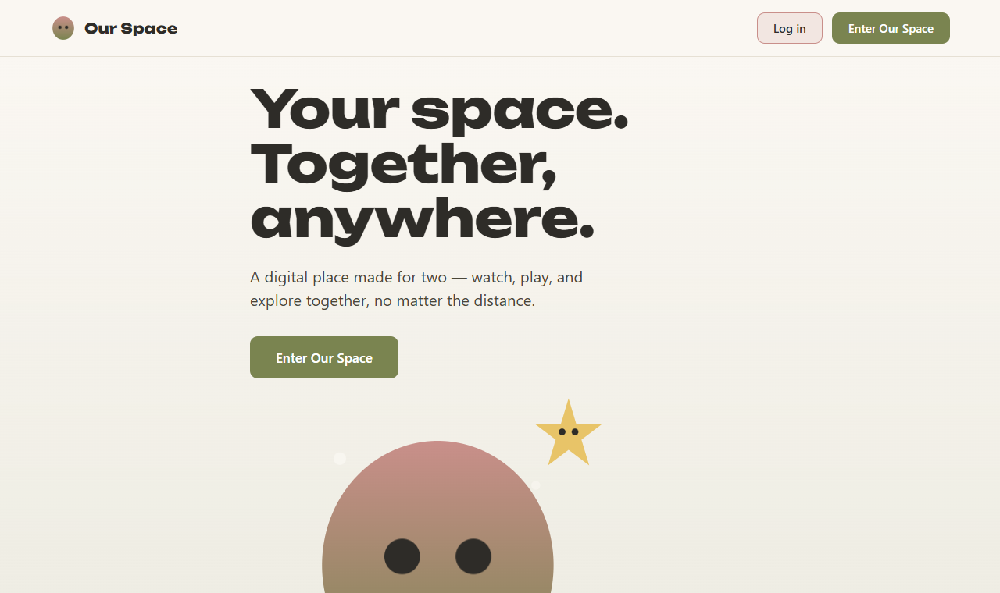
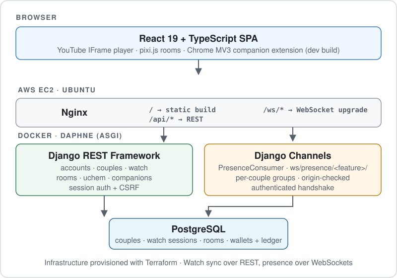

# Our Space

A private shared space for couples who live apart. Partners pair into one space, see each other in a shared room in real time, watch YouTube in sync, and build that space together.

**Live:** http://32.199.12.158
<br/>**Author:** Uche Onwe, independent project (Aug 2026 – present) · https://github.com/UcheOnwe

<a href="http://32.199.12.158"></a>

---

## At a Glance

| Area | Stack |
|---|---|
| **Backend** | Python 3.12+ · Django 6.1 · Django REST Framework · Django Channels (Daphne, ASGI) |
| **Frontend** | React 19 · TypeScript · Vite · pixi.js |
| **Data** | PostgreSQL 16 |
| **Realtime** | WebSockets for presence · REST with anchor-based drift correction for synced playback |
| **Testing** | 650+ frontend tests (Vitest, Testing Library) · 230+ backend test cases (Django test framework) |
| **Delivery** | GitHub Actions CI on every pull request · Docker · Nginx · AWS EC2 · Terraform |

## What It Does

- **Pairing:** one partner creates a space and shares a 6-character invite code; the other joins with it. A user can belong to only one couple, and the database enforces that.
- **Couple Home:** a shared room where both partners appear as live avatars. Movement, clicks, hugs and visibility changes reach the other partner over WebSockets.
- **Watch Together:** paste a YouTube link and both partners watch it in sync: load, play, pause and seek.
- **Rooms and Uchem:** couples unlock and switch between rooms (Couple Home, Cozy Loft, After Hours) using Uchem, an in-app currency held in personal and couple wallets.
- **Companions:** each partner customizes a companion. A Chrome extension (development build) shows the equipped companion on youtube.com.
- **Gaming (proof of concept):** embedded browser games from third-party providers inside the shared space.

## Engineering Highlights

- **Modular monolith:** seven Django apps with clear ownership, one deployable unit, and one database. I chose this deliberately over microservices for a project of this size.
- **Two realtime strategies, each chosen for its job:** WebSockets for high-frequency presence, and REST plus client-side drift correction for video sync. Details below.
- **Ledger with integrity guarantees:** wallet changes use row-level locks and idempotency keys, and database `CheckConstraint`s rule out negative balances and malformed transactions.
- **Every feature shipped as a vertical slice:** 14 feature branches merged through pull requests, each gated by CI (backend tests on PostgreSQL, migration check, lint, frontend tests, type-check, build).

## Architecture



The backend is one Django project with an app per domain. Cross-domain operations go through service functions where it matters; for example, buying a room debits the couple wallet through `uchem.services`, never by editing wallet rows directly.

| App | Owns |
|---|---|
| `accounts` | Custom `User`, registration, login/logout, CSRF priming, session restore |
| `couples` | `Couple`, `CoupleMembership` (one couple per user), `PairingInvite` (one pending code per couple) |
| `presence` | WebSocket consumer, per-couple groups, seat assignment |
| `watch` | `WatchSession`: one per couple, holding the current video and playback anchor |
| `rooms` | Room catalog, purchases, the couple's active room |
| `uchem` | Personal and couple wallets, `UchemTransaction` ledger |
| `companions` | Companion catalog and per-user companion profile |

The frontend is organized by feature (`features/auth`, `couples`, `presence`, `room`, `rooms`, `watch`, `uchem`, `companions`, `gaming`, `landing`). The shared room is rendered with pixi.js. Each feature owns its API client, context, components and tests.

## Realtime Design

The two realtime features have different needs, so they use different mechanisms.

**Presence → WebSockets** (`backend/presence/consumers.py`)
- Endpoint `ws/presence/<feature>/`, where `feature` comes from an explicit allowlist (`home`, `watch`).
- Each connection joins its couple's group, so messages only reach the partner.
- Connections must come through Django's session auth and an allowed origin (`AuthMiddlewareStack`, `AllowedHostsOriginValidator`). Unauthenticated, unpaired or invalid-feature connections are closed with distinct codes (4001, 4003, 4004).
- Avatar position, clicks, hugs and visibility (for example, when the video player covers an avatar) are broadcast as small JSON events.
- The channel layer is in-memory, which suits a single Daphne process. It is isolated in settings so it can be swapped for Redis if the app runs as multiple processes.

**Watch Together → REST with anchor-based drift correction** (`backend/watch`, `frontend/src/features/watch/sync.ts`)
- The server stores an *anchor*: video, status (playing or paused), position, and who changed it. It is written only on real events (load, play, pause, seek), never on a timer.
- Each client polls the session every 2 seconds and estimates the current position locally from the anchor and elapsed time.
- The YouTube IFrame API has no seek event, so a seek is inferred when actual playback drifts more than 2 seconds from the expected position.
- Remote state is applied only when the status differs or drift exceeds the threshold. Partners stay aligned without per-second database writes or a WebSocket protocol for playback.

## Authentication and Sessions

- Session-based auth (DRF `SessionAuthentication`) instead of tokens: the SPA and API share an origin, so the browser's session cookie is the simplest secure option.
- `GET /api/auth/csrf/` primes the CSRF cookie before any unsafe request, and `CSRF_TRUSTED_ORIGINS` lists the exact frontend origins.
- The SPA restores the logged-in user on load from `/api/auth/user-profile/`.
- WebSocket handshakes reuse the same session, so presence never accepts an anonymous connection.

## Data Integrity

- **One couple per user:** `CoupleMembership.user` is a `OneToOneField`, so the invariant lives in the schema, not just in application code.
- **Wallets:** `select_for_update()` serializes concurrent changes to the same wallet. A unique `idempotency_key` on every ledger row is the durable backstop against duplicate charges.
- **Constraints:** balances can't go negative, each transaction belongs to exactly one wallet, and amounts can't be zero. All three are enforced by PostgreSQL `CheckConstraint`s.

## Testing

| Suite | Tooling | Size |
|---|---|---|
| Frontend | Vitest · React Testing Library · jsdom | 78 test files, 653 tests (all passing at last full run) |
| Backend | Django test framework on PostgreSQL | 231 test cases across the seven apps |

CI (`.github/workflows/ci.yml`) runs on every pull request to `master`:
- **Backend:** a PostgreSQL 16 service container, `makemigrations --check` to catch missing migrations, and the full test suite.
- **Frontend:** `npm ci`, oxlint, Vitest, and `tsc -b && vite build`.

## Deployment

The production app runs on **AWS EC2 (Ubuntu)**:
- **Nginx** serves the built React app and proxies `/api/` (REST) and `/ws/` (WebSocket upgrade) to the backend.
- The backend runs as a **Docker** container: Daphne serving the ASGI application, which handles HTTP and WebSockets in one process.
- The AWS infrastructure was provisioned with **Terraform**.

In this repository: the backend `Dockerfile`, `docker-compose.yml` for local PostgreSQL, and the CI workflow. The Terraform and Nginx server configuration are kept outside this repository.

## Running Locally

**Prerequisites:** Python 3.12+, Node.js 22, Docker (for PostgreSQL).

**Backend** (http://localhost:8000):
```bash
cd backend
cp .env.example .env              # local defaults; Postgres on port 5433
docker compose up -d db           # PostgreSQL 16
python -m venv .venv
source .venv/bin/activate         # Windows: .venv\Scripts\activate
pip install -r requirements.txt
python manage.py migrate
python manage.py runserver 8000   # serves HTTP and WebSockets (daphne)
```

**Frontend** (http://localhost:5173):
```bash
cd frontend
npm ci
npm run dev
```
Vite proxies `/api` and `/ws` to `localhost:8000`, so session and CSRF cookies stay same-origin in development.

**Tests and checks:**
```bash
cd backend && python manage.py test
cd frontend && npm run lint && npm run test && npm run build
```

**Chrome extension (optional):** `npm run build:extension` in `frontend/`, then load `extension/` as an unpacked extension. See [extension/README.md](extension/README.md).

## Project Structure

```
backend/
  config/          settings, ASGI routing (HTTP + WebSocket), URLs
  accounts/  couples/  presence/  watch/  rooms/  uchem/  companions/
  Dockerfile  docker-compose.yml  requirements.txt
frontend/
  src/app/         auth and couple gates, app shell
  src/features/    one folder per feature (API client, context, components, tests)
  src/extension/   Chrome extension entry points
extension/         MV3 manifest; build output from frontend/
.github/workflows/ci.yml
```

## Engineering Decisions

- **Modular monolith over microservices.** A product of this size doesn't need network boundaries. Domain boundaries inside one codebase keep it simple to deploy and easy to split later.
- **REST by default, WebSockets only where needed.** Presence needs low-latency push; video sync doesn't. Anchor-based polling keeps playback state simple, durable and testable.
- **Sessions over JWT.** For a same-origin SPA, cookie sessions with CSRF protection avoid storing tokens in the browser.
- **Invariants in the database.** One-couple-per-user, non-negative balances and idempotent ledger writes are enforced by PostgreSQL, not just by service code.
- **Small, verified slices.** Each feature went through a feature branch, a PR and CI. I use Claude Code as an engineering assistant under explicit project constraints ([CLAUDE.md](CLAUDE.md)). I review every change and own architecture, testing and deployment decisions.

## Known Limits

- The in-memory channel layer assumes a single backend process; scaling out means switching to Redis.
- The Chrome extension is a development build and isn't on the Chrome Web Store.
